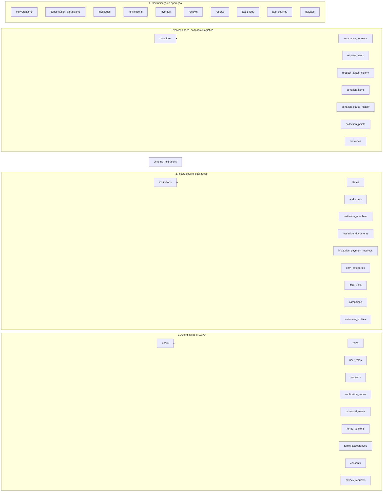
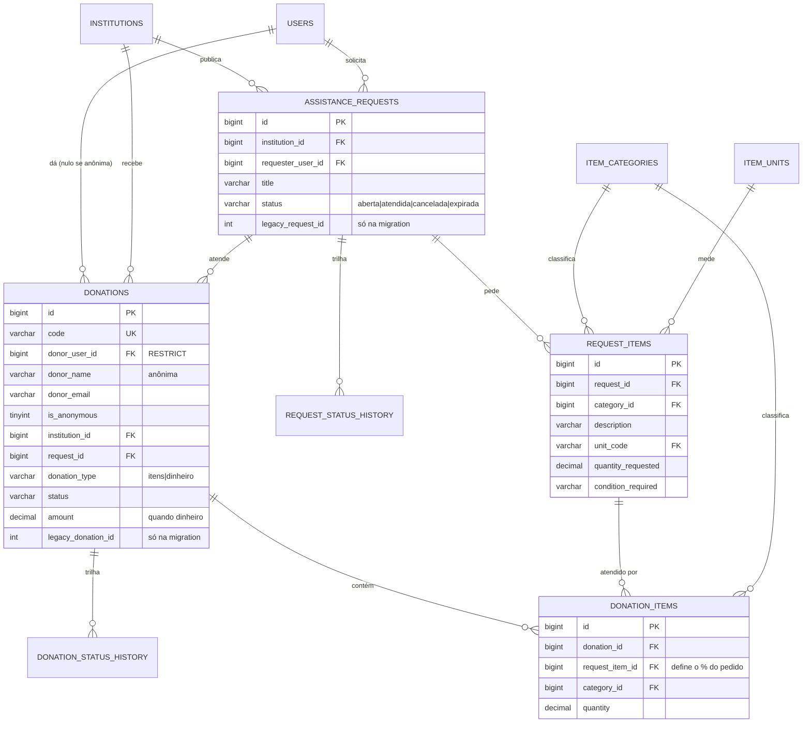
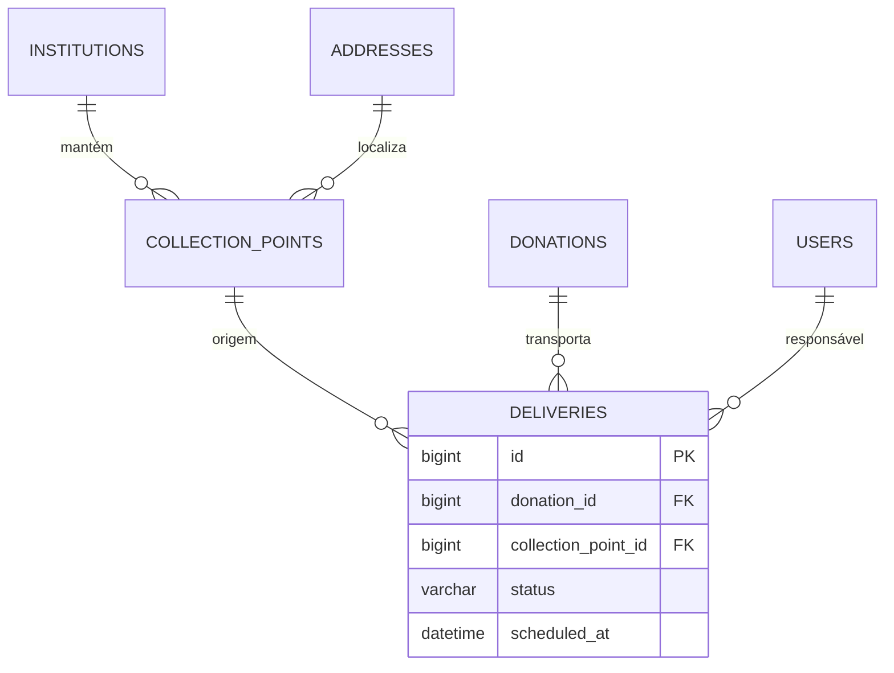
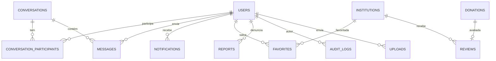

# DER — Diagrama de Entidade e Relacionamento — AjudaMais

Modelo do banco `ajudamais`: **39 tabelas base**, **5 views**, **76 chaves
estrangeiras**. Diagrama em Mermaid (renderiza no GitHub, no VS Code e no
MySQL Workbench via *Reverse Engineer*).

---

## Visão geral (domínios)



---

## Núcleo: usuários, papéis e instituições

```mermaid
erDiagram
  USERS ||--o{ USER_ROLES : "possui"
  ROLES ||--o{ USER_ROLES : "atribuído a"
  USERS ||--o{ SESSIONS : "abre"
  USERS ||--o{ VERIFICATION_CODES : "recebe"
  USERS ||--o{ PASSWORD_RESETS : "solicita"
  USERS ||--o{ TERMS_ACCEPTANCES : "aceita"
  TERMS_VERSIONS ||--o{ TERMS_ACCEPTANCES : "versão aceita"
  USERS ||--o{ CONSENTS : "concede"
  USERS ||--o{ PRIVACY_REQUESTS : "solicita"
  USERS ||--o{ ADDRESSES : "tem"
  INSTITUTIONS ||--o{ ADDRESSES : "tem"
  INSTITUTIONS ||--o{ INSTITUTION_MEMBERS : "tem equipe"
  USERS ||--o{ INSTITUTION_MEMBERS : "participa"
  INSTITUTIONS ||--o{ INSTITUTION_DOCUMENTS : "envia"
  INSTITUTIONS ||--o{ INSTITUTION_PAYMENT_METHODS : "recebe em"
  INSTITUTIONS ||--o{ CAMPAIGNS : "cria"
  USERS ||--o{ VOLUNTEER_PROFILES : "é voluntário"
  STATES ||--o{ ADDRESSES : "UF"

  USERS {
    bigint id PK
    varchar full_name
    varchar email UK
    char cpf UK "11 dígitos"
    varchar phone_e164
    varchar password_hash
    varchar status "pendente|ativo|..."
    datetime deleted_at "exclusão lógica"
    int legacy_user_id "só na migration"
  }
  INSTITUTIONS {
    bigint id PK
    varchar legal_name
    char cnpj UK "14 dígitos"
    varchar email
    varchar phone_e164
    varchar status "pendente|verificada|..."
    datetime deleted_at
    int legacy_institution_id "só na migration"
  }
  ROLES {
    bigint id PK
    varchar code UK "doador|beneficiario|instituicao|moderador|admin|voluntario"
  }
```



---

## Necessidades → itens → doações



**Regra declarativa da doação** (garantida pelo banco, não por código):

```sql
CONSTRAINT chk_donations_identifier
  CHECK ((donor_user_id IS NULL) = (is_anonymous = 1))
```

E ao excluir um usuário, a trigger `trg_users_before_delete` **anonimiza** as
doações dele antes do `DELETE`, preservando o histórico (LGPD).

---

## Logística



---

## Comunicação, engajamento e moderação



---

## Colunas que existem apenas na migration

As colunas `legacy_user_id`, `legacy_institution_id`, `legacy_donation_id` e
`legacy_request_id` **não fazem parte de `01-schema.sql`**. Elas são criadas por
`02-migration.sql` para guardar o `id` da tabela antiga e impedir cópia duplicada
(nascem com `UNIQUE`). A tabela `role_legacy_backup` segue a mesma regra: só
existe depois da migration.

---

## Views (não são tabelas, servem de leitura pronta)

| View | Retorna |
|---|---|
| `v_institutions_public` | instituições ativas com contato e endereço principal |
| `v_request_items_progress` | cada item pedido com recebido, faltante e `computed_status` |
| `v_request_progress` | total pedido x recebido por necessidade e `percent_complete` |
| `v_donations_overview` | doações com doador, instituição e quantidade de itens |
| `v_institution_impact` | somas de itens, valores e necessidades por instituição |

---

## Regras de integridade aplicadas no banco

| Tipo | Quantidade | Exemplos |
|---|---|---|
| Chaves primárias | 39 | `id` em todas as tabelas |
| Chaves estrangeiras | 76 | com `RESTRICT`, `CASCADE` ou `SET NULL` conforme o caso |
| CHECK | 49 | CPF/CNPJ/CEP com 11/14/8 dígitos, status válido, quantidades ≥ 0, `chk_donations_identifier` |
| UNIQUE | várias | `users.email`, `users.cpf`, `institutions.cnpj`, `donations.code` |
| Trigger | 1 | anonimização de doações ao excluir usuário |
| Índices | 149 | chaves estrangeiras e colunas de busca/filtro |

> **Como abrir o DER no MySQL Workbench:** menu *Database → Reverse Engineer*
> (Ctrl+R), aponte para a conexão local, escolha o schema `ajudamais` e marque
> as tabelas. O Workbench desenha as relações a partir das 76 FKs reais.
